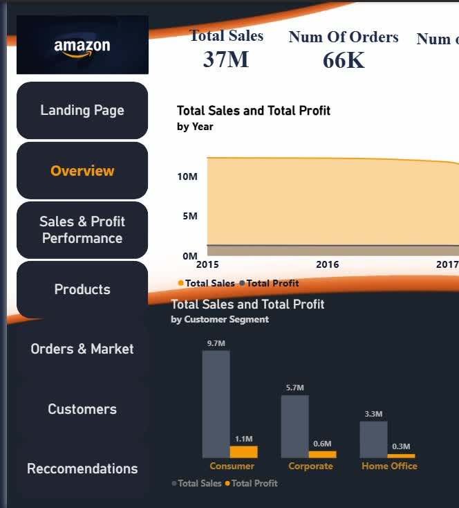
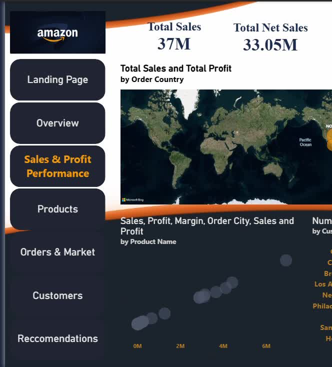
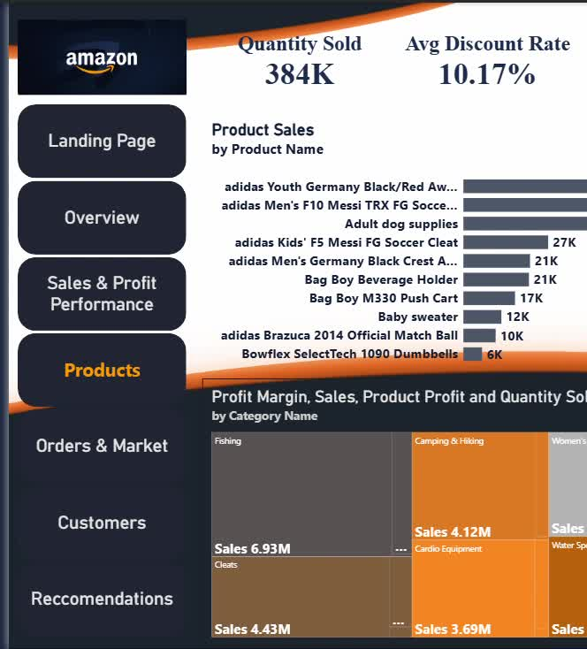
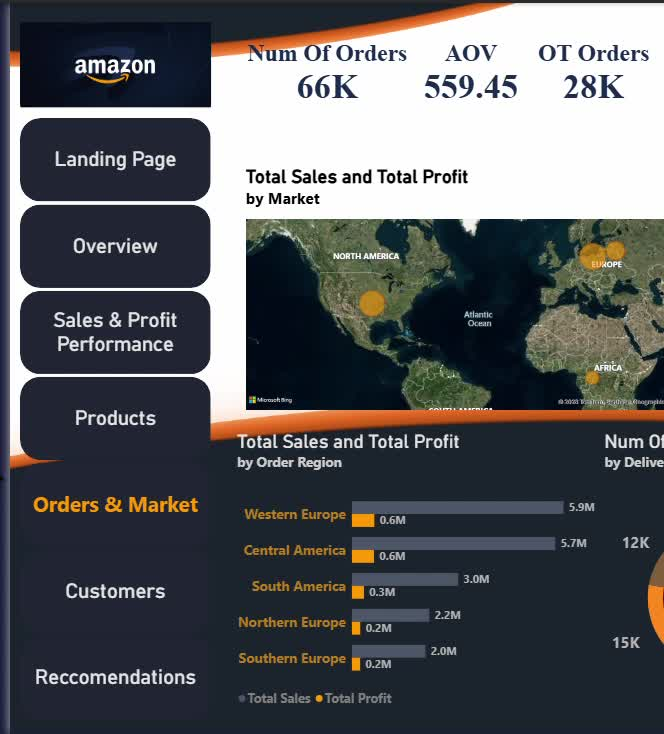
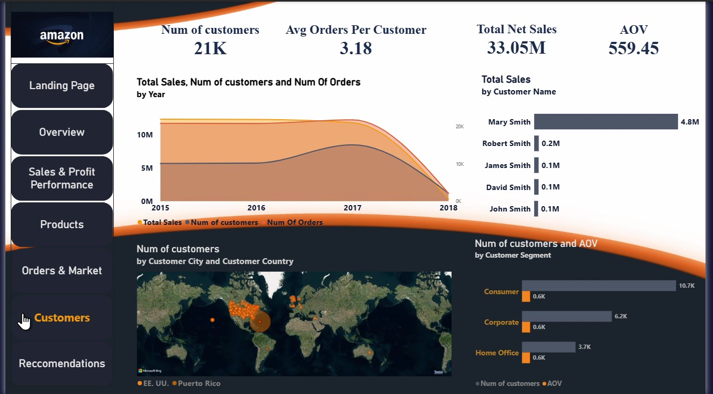
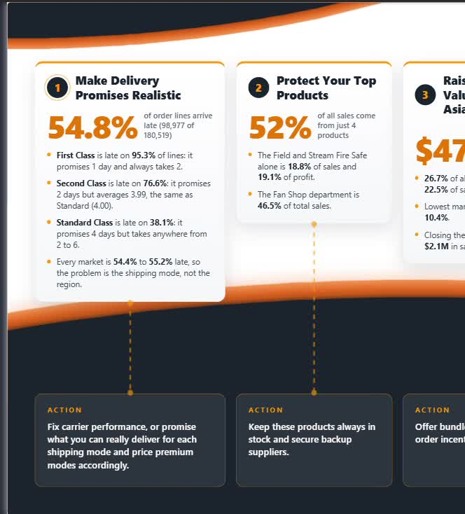

# Amazon-Inspired Supply Chain Performance Analysis

**Tools:** Microsoft Power BI · Power Query · DAX  
**Project Type:** Interactive Supply Chain Performance Report  
**Dataset:** Project dataset analyzed in this collaborative portfolio project

## Project Overview

This project presents an interactive, multi-page Power BI report exploring supply chain performance across delivery reliability, orders, products, markets, sales, profitability, and customer behavior. The analysis highlights operational pressure points and translates them into recommendations focused on fulfillment performance, product availability, customer retention, market profitability, and open orders.

The report uses an Amazon-inspired visual theme for presentation purposes. This is an independent portfolio project and is not affiliated with or endorsed by Amazon.

## Report Preview

| Executive Overview | Sales & Profit Performance |
|:---:|:---:|
|  |  |
| Product Analysis | Orders & Market |
|  |  |
| Customer Analysis | Recommendations |
|  |  |

[View the custom landing-page screenshot](landing-page.jpg)

## Report Structure

- **Landing Page:** Introduces the project through an Amazon-inspired visual theme and report navigation.
- **Executive Overview:** Summarizes sales, orders, customers, average order value, profit, and profit margin.
- **Sales & Profit Performance:** Examines sales and profitability across markets and business segments.
- **Product Analysis:** Reviews product performance, quantities sold, profit margins, and sales concentration.
- **Orders & Market:** Explores order activity, shipping methods, order statuses, and delivery performance across markets.
- **Customer Analysis:** Reviews customer contribution, order frequency, sales, profitability, and average order value.
- **Recommendations:** Presents actions based on the report's key findings.

## Key Analytical Areas

- Supply chain and delivery performance
- On-time delivery and late-delivery rates by shipping method and market
- Order status and pending-payment backlog
- Sales, profit, and profit margin across markets
- Product sales contribution and concentration risk
- Customer purchasing frequency and sales contribution
- KPI reporting and business-focused data storytelling

## Recommendations

1. **Improve delivery reliability** by comparing promised and actual delivery times by shipping method, reviewing unrealistic service promises, and monitoring on-time delivery.
2. **Protect high-performing products** by reviewing demand and replenishment needs for the products that contribute most to sales and considering appropriate safety stock or backup suppliers.
3. **Investigate Pacific Asia profitability** by reviewing product mix, order value, and cost-to-serve, then testing bundles or minimum-order incentives where appropriate.
4. **Encourage repeat purchasing** through second-order offers and loyalty incentives, while monitoring repeat rate and customer profitability.
5. **Reduce the pending-payment backlog** by reviewing open orders by age and value and determining which require follow-up, collection, or cancellation.

## Technical Skills Demonstrated

- Data cleaning and preparation with Power Query
- DAX measures and KPI calculations
- Interactive visualization and multi-page Power BI report design
- Supply chain, delivery, and order-status analysis
- Sales, profit, product, market, and customer analysis
- Business recommendations and analytical storytelling
- Collaborative project coordination and report-page integration

## Explore the Project

- **[Open the published Power BI report](https://app.powerbi.com/groups/me/reports/f2f187d5-c891-4db1-a90f-0bbc4a29ad20/5b890d4ecb107441419a?experience=power-bi)**
- **[Watch the Power BI walkthrough on YouTube](https://youtu.be/EJp5Qin4I58)**
- **[Download the Power BI report (.pbix)](Supply%20Chain%20-%20Full%20Report.pbix)**
- **[Download the executive presentation (.pptx)](Amazon-inspired-Supply-chain-performance-and-logistics-intelligence.pptx)**

## Project Reflection

This collaborative project strengthened my experience using Power BI to bring multiple analytical pages into one consistent supply-chain performance report. As team leader, I coordinated the work and helped integrate the pages into a unified report experience. The project developed my skills in KPI reporting, operational performance analysis, dashboard storytelling, and translating findings into practical recommendations.

## About Me

**Claudia Al-Amir** | Data Analyst

[LinkedIn](https://www.linkedin.com/in/claudia-al-amir-131199424) · [Email](mailto:claudiaalamir21@gmail.com)
